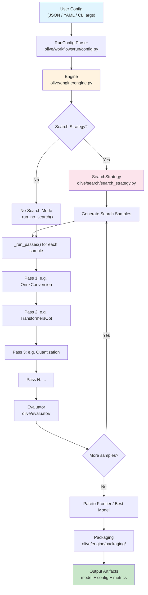
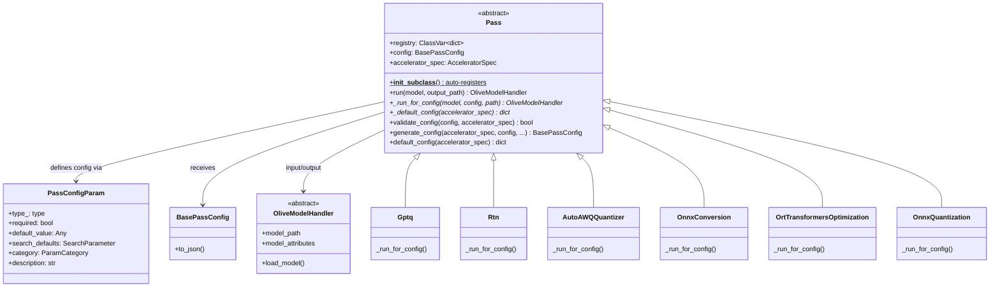
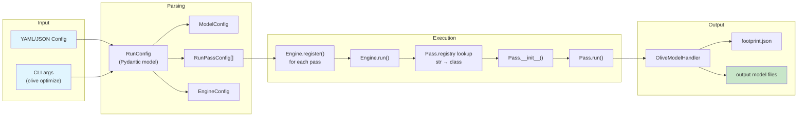
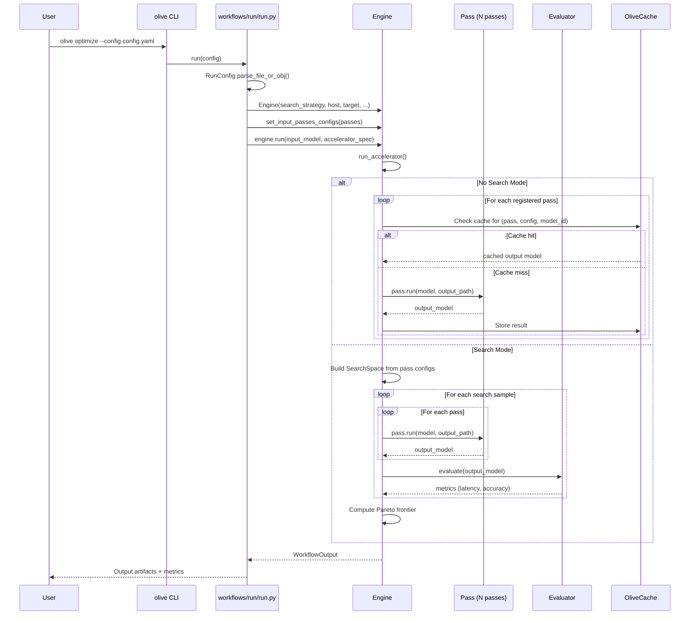
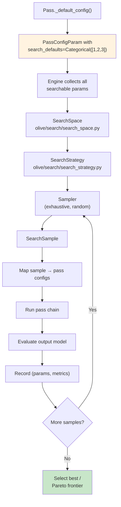

# Microsoft Olive — Comprehensive Onboarding Guide

> **Generated from source analysis of [microsoft/Olive](https://github.com/microsoft/Olive)**
> For contributors starting model optimization work — actionable, code-level detail.

---

## Table of Contents

1. [Why Olive Exists](#1-why-olive-exists)
2. [Architecture](#2-architecture)
3. [Pass System](#3-pass-system)
4. [Key Files — Codebase Map](#4-key-files--codebase-map)
5. [Configuration](#5-configuration)
6. [Quantization Passes](#6-quantization-passes-in-depth)
7. [Limitations](#7-limitations)
8. [How to Add a New Feature](#8-how-to-add-a-new-feature)

---

## 1. Why Olive Exists

### The Problem

Deploying an AI model efficiently on a specific hardware target requires a **chain of optimization steps**: export → graph optimization → quantization → calibration → EP-specific compilation. Each step has its own tool:

| Step | Standalone Tool | Problem with using it directly |
|------|----------------|-------------------------------|
| Export to ONNX | `torch.onnx.export` | Requires manual I/O config, dynamic axes, opset selection |
| Graph optimization | `onnxruntime.transformers.optimizer` | Manual model-type detection, fusion rules |
| Quantization (GPTQ) | `auto-gptq` | Only produces PyTorch checkpoints; no ONNX pipeline |
| Quantization (AWQ) | `autoawq` | GPU-only, no ONNX export integration |
| INT8 quantization | `onnxruntime.quantization` | Needs calibration data pipeline, pre-processing |
| EP compilation | `trtexec`, QNN tools | Completely separate toolchains |

**Users must glue these tools together manually**, handle intermediate formats, manage hardware-specific constraints, and repeat the process for each target (CPU, CUDA, DML, QNN, OpenVINO).

### What Olive Does

Olive is a **unified optimization pipeline** that:

1. **Composes** the best optimization techniques into a single DAG of "passes"
2. **Abstracts** hardware targets — one config works across CPU/CUDA/DML/QNN/OpenVINO
3. **Auto-tunes** hyperparameters (quantization bits, group size, etc.) via search strategies
4. **Caches** intermediate results so you don't re-run expensive steps
5. **Packages** the output into deployment-ready artifacts

```
┌──────────────┐    ┌───────────────┐    ┌──────────────────┐    ┌─────────────┐
│ HuggingFace  │───▶│  Olive Engine │───▶│ Optimized ONNX   │───▶│ Deploy on   │
│ Model        │    │  (Pass Chain) │    │ + Config         │    │ CPU/GPU/NPU │
└──────────────┘    └───────────────┘    └──────────────────┘    └─────────────┘
```

**Key insight**: Olive isn't a replacement for GPTQ/AWQ/trtexec — it's an **orchestrator** that calls them in the right order with the right settings for your target hardware.

---

## 2. Architecture

### 2.1 Full Pipeline Flow



### 2.2 Pass System Architecture



### 2.3 Config → Passes → Output Flow



### 2.4 Engine Execution Detail



---

## 3. Pass System

### 3.1 How Passes Are Defined

Every pass inherits from `Pass` (ABC) in `olive/passes/olive_pass.py`. Registration is **automatic** via `__init_subclass__`:

```python
# olive/passes/olive_pass.py (simplified)
class Pass(ABC):
    registry: ClassVar[dict[str, type["Pass"]]] = {}

    @classmethod
    def __init_subclass__(cls, **kwargs):
        super().__init_subclass__(**kwargs)
        if not inspect.isabstract(cls):
            cls.registry[cls.__name__.lower()] = cls  # auto-register!

    @abstractmethod
    def _default_config(cls, accelerator_spec) -> dict[str, PassConfigParam]:
        """Define parameters this pass accepts."""
        ...

    def run(self, model: OliveModelHandler, output_model_path: str) -> OliveModelHandler:
        """Public entry: handles composite/distributed models, then calls _run_for_config."""
        ...
        output_model = self._run_for_config(model, self.config, output_model_path)
        ...

    @abstractmethod
    def _run_for_config(self, model, config, output_model_path) -> OliveModelHandler:
        """Override this — your actual optimization logic."""
        ...
```

**To create a pass, you only need to**:
1. Subclass `Pass`
2. Implement `_default_config()` → define your parameters
3. Implement `_run_for_config()` → your optimization logic

### 3.2 Real Pass Example: GPTQ

```python
# olive/passes/pytorch/gptq.py
class Gptq(Pass):
    """GPTQ quantization."""

    @classmethod
    def _default_config(cls, accelerator_spec):
        return {
            **get_quantizer_config(),           # bits, group_size, sym, lm_head, overrides
            "damp_percent": PassConfigParam(
                type_=float, default_value=0.01,
                description="Damping factor for Hessian inverse.",
            ),
            "desc_act": PassConfigParam(
                type_=bool, default_value=None,
                description="Whether to use act-order scheme.",
            ),
            "data_config": PassConfigParam(
                type_=Union[DataConfig, dict], default_value=None,
                description="Calibration data config.",
            ),
        }

    @classmethod
    def validate_config(cls, config, accelerator_spec):
        if config.group_size <= 0 and config.group_size != -1:
            return False
        if config.desc_act is True and config.group_size != -1:
            return False
        return True

    @torch.no_grad()
    def _run_for_config(self, model, config, output_model_path):
        wrapper, qcfg, _ = prepare_model(model, config)
        device = run_layerwise_quantization(
            model, wrapper, config.data_config,
            input_hook=self.accumulate_hessian,
            process_module=lambda module, _: self.process_module(
                module, percdamp=config.damp_percent, actorder=config.desc_act
            ),
        )
        return finalize(model, output_model_path, wrapper, qcfg, device)
```

### 3.3 ALL Available Passes

#### ONNX Passes (`olive/passes/onnx/`)

| Pass Class | Purpose |
|-----------|---------|
| `OnnxConversion` | PyTorch → ONNX export |
| `OnnxOpVersionConversion` | Convert ONNX opset version |
| `OptimumConversion` | Export via HF Optimum |
| `OptimumMerging` | Merge Optimum-exported models |
| `OrtTransformersOptimization` | ORT transformer fusions (attention, LayerNorm, etc.) |
| `OnnxPeepholeOptimizer` | Small graph-level simplifications |
| `OnnxScriptFusion` | Pattern-based ONNX Script fusions |
| `OnnxFloatToFloat16` | FP32 → FP16 conversion |
| `OrtMixedPrecision` | Mixed precision assignment |
| `MixedPrecisionOverrides` | Manual override of op precision |
| `OnnxIODataTypeConverter` | Change model I/O data types |
| `OnnxQuantization` | Base ONNX quantization (static/dynamic) |
| `OnnxDynamicQuantization` | Dynamic INT8 quantization |
| `OnnxStaticQuantization` | Static INT8 quantization (needs calibration) |
| `OnnxQuantizationPreprocess` | Pre-processing for quantization |
| `OnnxBlockWiseRtnQuantization` | Block-wise RTN (INT4/NF4) |
| `OnnxBnb4Quantization` | BitsAndBytes 4-bit quantization |
| `OnnxHqqQuantization` | Half-Quadratic Quantization |
| `OnnxKQuantQuantization` | K-Quant quantization |
| `IncQuantization` | Intel Neural Compressor quantization |
| `AimetQuantization` | Qualcomm AIMET quantization |
| `NVModelOptQuantization` | NVIDIA ModelOpt quantization |
| `NVModelOptGraphSurgery` | NVIDIA ModelOpt graph surgery |
| `StaticLLM` | Static LLM optimization |
| `ModelBuilder` | ORT GenAI model builder |
| `DynamicToFixedShape` | Convert dynamic shapes to fixed |
| `SplitModel` | Split model for multi-device |
| `ExtractAdapters` | Extract LoRA adapters from model |
| `ComposeOnnxModels` | Compose multiple ONNX models |
| `MatMulNBitsToQDQ` | Convert MatMulNBits to QDQ |
| `GraphSurgeries` | Custom graph modifications |
| `EPContextBinaryGenerator` | Generate EP context binaries |
| `AddOliveMetadata` | Add Olive metadata to model |
| `InputNCHWtoNHWC` | Convert input layout |
| `OrtSessionParamsTuning` | Auto-tune ORT session params |
| `QNNPreprocess` | QNN EP preprocessing |
| `QairtMHA2SHA` | Convert MHA to SHA for QAIRT |
| `VitisAIAddMetaData` | Vitis AI metadata |
| `VitisGenerateModelLLM` | Vitis AI LLM model generation |

#### PyTorch Passes (`olive/passes/pytorch/`)

| Pass Class | Purpose |
|-----------|---------|
| `Gptq` | Native GPTQ quantization (Olive-owned) |
| `GptqQuantizer` | AutoGPTQ wrapper |
| `GptqModel` | GPTQModel library wrapper |
| `AutoAWQQuantizer` | AutoAWQ wrapper |
| `Rtn` | Round-to-nearest quantization |
| `AutoClip` | Automatic clipping for quantization |
| `SparseGPT` | Sparsity via SparseGPT |
| `SliceGPT` | Model compression via SliceGPT |
| `RotateBase` | QuaRot/SpinQuant rotation |
| `SelectiveMixedPrecision` | Layer-wise mixed precision |
| `LoRA` | LoRA/QLoRA fine-tuning |
| `MergeAdapterWeights` | Merge adapter into base model |
| `CaptureSplitInfo` | Capture model split metadata |
| `CaptureLayerAnnotations` | Capture layer annotation metadata |

#### OpenVINO Passes (`olive/passes/openvino/`)

| Pass Class | Purpose |
|-----------|---------|
| `OpenVINOConversion` | Convert to OpenVINO IR |
| `OpenVINOOptimumConversion` | Convert via HF Optimum for OpenVINO |
| `OpenVINOWeightCompression` | Weight compression (NNCF) |
| `OpenVINOQuantizationBase` | Base OpenVINO quantization |
| `OpenVINOEncapsulation` | Package as OpenVINO model |
| `OpenVINOIoUpdate` | Update I/O configs |

#### QNN Passes (`olive/passes/qnn/`)

| Pass Class | Purpose |
|-----------|---------|
| `QNNConversion` | Convert to QNN format |
| `QNNModelLibGenerator` | Generate QNN model library |
| `QNNContextBinaryGenerator` | Generate QNN context binary |

#### QAIRT Passes (`olive/passes/qairt/`)

| Pass Class | Purpose |
|-----------|---------|
| `QairtPreparation` | Prepare model for QAIRT |
| `QairtEncapsulation` | Package as QAIRT model |
| `QairtGenAIBuilder` | QAIRT GenAI model builder |

#### Other Passes

| Pass Class | Location | Purpose |
|-----------|----------|---------|
| `SDLoRA` | `olive/passes/diffusers/` | Stable Diffusion LoRA |
| `QuarkQuantization` | `olive/passes/quark_quantizer/` | Quark quantization |

### 3.4 How Passes Are Chained

The engine runs passes **sequentially in registration order**. Each pass's output model becomes the next pass's input:

```python
# olive/engine/engine.py (simplified)
def _run_passes(self, model_config, model_id, accelerator_spec):
    for pass_name in self.computed_passes_configs:
        model_config, model_id = self._run_pass(
            pass_name, model_config, model_id, accelerator_spec
        )
        if model_config in PRUNED_CONFIGS:
            break  # stop if pass failed/invalid
    return should_prune, signal, model_ids
```

Each `_run_pass()` call:
1. Checks cache for existing results
2. Instantiates the pass class from registry
3. Calls `pass.run(model, output_path)`
4. Records result in footprint
5. Returns new `(model_config, model_id)` for next pass

### 3.5 Search / Auto-Tuning



Parameters become searchable by setting `search_defaults`:

```python
"param3": PassConfigParam(
    type_=int,
    default_value=1,
    search_defaults=Categorical([1, 2, 3]),  # ← makes it searchable
    description="param3 description",
),
```

---

## 4. Key Files — Codebase Map

### 4.1 Directory Tree (Top 3 Levels)

```
olive/
├── cli/                          # CLI commands
│   ├── launcher.py               # ★ Entry point: main()
│   ├── auto_opt.py               # olive auto-opt command
│   ├── optimize.py               # olive optimize command
│   ├── quantize.py               # olive quantize command
│   └── finetune.py               # olive finetune command
├── common/                       # Shared utilities
│   ├── hf/                       # HuggingFace helpers
│   │   ├── quant.py              # Export-compatible quant helpers
│   │   └── io_config/            # I/O configuration utilities
│   └── quant/                    # Quantization core
│       ├── utils.py              # ★ WeightQuantizer class
│       └── hf_utils.py           # HF quantization integration
├── engine/                       # Core execution engine
│   ├── engine.py                 # ★ Engine class - runs the pipeline
│   ├── config.py                 # EngineConfig, RunPassConfig
│   ├── footprint.py              # Run tracking
│   ├── output.py                 # WorkflowOutput
│   └── packaging/                # Output artifact packaging
├── passes/                       # ★ All optimization passes
│   ├── olive_pass.py             # ★ Pass base class (ABC)
│   ├── pass_config.py            # PassConfigParam, BasePassConfig
│   ├── __init__.py               # REGISTRY = Pass.registry
│   ├── onnx/                     # ONNX passes (35+ passes)
│   ├── pytorch/                  # PyTorch passes (14+ passes)
│   ├── openvino/                 # OpenVINO passes
│   ├── qnn/                      # QNN passes
│   ├── qairt/                    # QAIRT passes
│   ├── diffusers/                # Diffusion model passes
│   └── quark_quantizer/          # Quark quantization
├── model/                        # Model handler abstractions
│   ├── handler/                  # HfModel, ONNXModel, PyTorchModel, etc.
│   └── config/                   # ModelConfig, I/O config
├── evaluator/                    # Model evaluation
│   ├── olive_evaluator.py        # Evaluator orchestration
│   └── metric.py                 # Metric definitions
├── search/                       # Search / auto-tuning
│   ├── search_strategy.py        # SearchStrategy
│   ├── search_space.py           # SearchSpace
│   └── samplers/                 # Exhaustive, random samplers
├── workflows/
│   └── run/
│       ├── config.py             # ★ RunConfig - top-level config model
│       └── run.py                # ★ Workflow entry point
├── systems/                      # Execution targets
│   └── system_config.py          # LocalSystem, Docker, etc.
├── hardware/                     # Hardware abstractions
│   ├── accelerator.py            # AcceleratorSpec
│   └── constants.py              # EP definitions, device mappings
└── data/                         # Data pipeline
    ├── config.py                 # DataConfig
    ├── component/                # Dataset, dataloader components
    └── container/                # HF, dummy, image data containers
```

### 4.2 Files to Read First (In Order)

| Priority | File | Why |
|----------|------|-----|
| 1 | `olive/passes/olive_pass.py` | The `Pass` ABC — everything extends this |
| 2 | `olive/passes/pass_config.py` | `PassConfigParam` — how pass configs are defined |
| 3 | `olive/engine/engine.py` | The `Engine` — orchestrates everything |
| 4 | `olive/workflows/run/config.py` | `RunConfig` — the top-level config model |
| 5 | `olive/workflows/run/run.py` | Entry point for `olive run` / `olive optimize` |
| 6 | `olive/passes/pytorch/gptq.py` | A real pass — good template |
| 7 | `olive/passes/pytorch/rtn.py` | Simplest possible pass (12 lines of logic) |
| 8 | `olive/cli/launcher.py` | CLI dispatch to understand user-facing commands |

### 4.3 Where to Add a New Pass

```
olive/passes/<backend>/my_new_pass.py    # Create your pass file here
                                          # It auto-registers via __init_subclass__
olive/passes/<backend>/__init__.py        # Import your class here
test/passes/<backend>/test_my_new_pass.py # Add tests here
```

### 4.4 CLI Entry Point

```python
# setup.py
entry_points={"console_scripts": ["olive=olive.cli.launcher:main"]}

# olive/cli/launcher.py
def main():
    parser = argparse.ArgumentParser("Olive")
    # registers subcommands: optimize, auto-opt, quantize, finetune, etc.
    args, extra_args = parser.parse_known_args()
    args.func(args, extra_args).run()
```

---

## 5. Configuration

### 5.1 Full YAML Config Example

```yaml
# olive-config.yaml
input_model:
  type: HfModel
  model_path: microsoft/Phi-3-mini-4k-instruct

systems:
  local_system:
    type: LocalSystem
    accelerators:
      - device: gpu
        execution_providers:
          - CUDAExecutionProvider

data_configs:
  - name: calib_data
    type: HuggingfaceContainer
    load_dataset_config:
      data_name: wikitext
      subset: wikitext-2-raw-v1
      split: train[:128]

passes:
  onnx_conversion:
    type: OnnxConversion
    torch_dtype: float32

  transformer_opt:
    type: OrtTransformersOptimization
    opt_level: 0
    float16: true
    keep_io_types: true

  quantization:
    type: OnnxStaticQuantization
    precision: int8
    data_config: calib_data
    calibrate_method: MinMax
    per_channel: true
    quant_preprocess: true

engine:
  search_strategy: null        # null = no search, just run passes in order
  evaluate_input_model: false
  output_dir: ./olive-output
  cache_dir: .olive-cache

host: local_system
target: local_system
```

### 5.2 Config Sections Explained

| Section | Class | Purpose |
|---------|-------|---------|
| `input_model` | `ModelConfig` | Model source: HfModel, PyTorchModel, ONNXModel, etc. |
| `systems` | `dict[str, SystemConfig]` | Named execution environments (local, docker, etc.) |
| `data_configs` | `list[DataConfig]` | Named datasets for calibration, evaluation |
| `passes` | `dict[str, RunPassConfig]` | Ordered dict of pass name → pass configuration |
| `engine` | `RunEngineConfig` | Search strategy, caching, output settings |
| `evaluators` | `dict[str, OliveEvaluatorConfig]` | Optional: metrics to evaluate models |
| `host` | `str` reference | System where passes execute |
| `target` | `str` reference | System where model is deployed/evaluated |

### 5.3 EP-Specific Configurations

The accelerator/EP determines which passes are compatible:

```yaml
# CUDA target
accelerators:
  - device: gpu
    execution_providers: [CUDAExecutionProvider]

# DirectML target (Windows GPU)
accelerators:
  - device: gpu
    execution_providers: [DmlExecutionProvider]

# CPU target
accelerators:
  - device: cpu
    execution_providers: [CPUExecutionProvider]

# QNN target (Qualcomm NPU)
accelerators:
  - device: npu
    execution_providers: [QNNExecutionProvider]
```

**Device → EP mapping** (from `olive/hardware/constants.py`):

| Device | Supported EPs |
|--------|--------------|
| `cpu` | CPU, OpenVINO |
| `gpu` | CUDA, ROCM, DML, TensorRT, MIGraphX, NvTensorRTRTX, QNN, WebGpu |
| `npu` | DML, QNN, VitisAI, OpenVINO |

The `auto-opt` command auto-selects passes based on EP. For example, `DmlExecutionProvider` skips CUDA-only passes and adds DML-specific preprocessing.

### 5.4 Quick CLI Usage (No Config File)

```bash
# Automatic optimization — minimal setup
olive auto-opt \
  --model_name_or_path microsoft/Phi-3-mini-4k-instruct \
  --device gpu \
  --provider cuda \
  --precision int4 \
  --output_path ./optimized

# Quantize only
olive quantize \
  --model_name_or_path microsoft/Phi-3-mini-4k-instruct \
  --algorithm gptq \
  --precision int4

# Fine-tune with LoRA
olive finetune \
  --model_name_or_path microsoft/Phi-3-mini-4k-instruct \
  --data_name nampdn-ai/tiny-codes \
  --method lora
```

---

## 6. Quantization Passes In Depth

### 6.1 GPTQ — Native Olive Implementation

**File**: `olive/passes/pytorch/gptq.py`

Olive has its **own GPTQ implementation** (not a wrapper). It uses Cholesky-based Hessian inverse for optimal weight quantization.

```
Flow: Load model → prepare_model() → run_layerwise_quantization() → finalize()
                                        ├── accumulate_hessian()  — builds H matrix from activations
                                        └── process_module()      — Cholesky decompose, quantize weights
```

**Key parameters**:
- `bits`: 2, 4, or 8 (default: 4)
- `group_size`: quantization group size (default: 128, -1 for per-column)
- `sym`: symmetric quantization (default: False)
- `damp_percent`: Hessian damping factor (default: 0.01)
- `desc_act`: activation ordering (default: None → auto)
- `data_config`: calibration dataset

**Core math** (in `process_module()`):
```python
# 1. Compute Hessian inverse via Cholesky decomposition
H = (2 * self.H) / self.N  # average Hessian
damp = percdamp * torch.diag(H).mean()
H[diag] += damp
H_inv = torch.linalg.cholesky(H)
H_inv = torch.cholesky_inverse(H_inv)

# 2. Quantize column-by-column using optimal rounding
for col in range(columns):
    w = W[:, col]
    q = quantizer.quantize(w)       # round to nearest quantization level
    err = (w - q) / H_inv[col, col] # error correction
    W[:, col:] -= err.unsqueeze(1) * H_inv[col, col:]  # update remaining weights
```

### 6.2 AWQ — AutoAWQ Wrapper

**File**: `olive/passes/pytorch/autoawq.py`

AWQ is a **wrapper** around the `autoawq` library. It finds activation-aware scaling factors before quantization.

```python
# Simplified flow
from awq import AutoAWQForCausalLM

awq_model = AutoAWQForCausalLM.from_pretrained(model_path)
awq_model.quantize(tokenizer, quant_config={
    "zero_point": True,    # asymmetric quantization
    "q_group_size": 128,   # group size
    "w_bit": 4,            # bit width
    "version": "gemm",     # kernel version (gemm or gemv)
})
awq_model.save_quantized(output_path)
```

**Key parameters**:
- `bits`: 4 (default)
- `q_group_size`: 128 (default)
- `zero_point`: True = asymmetric (default)
- `version`: "gemm" (large batch) or "gemv" (small batch)
- `duo_scaling`: scale by both weights and activations (default: True)
- `export_compatible`: FP16 scales only, no real quantization

**Requirement**: GPU required (`torch.cuda.is_available()`)

### 6.3 RTN — Round-to-Nearest

**File**: `olive/passes/pytorch/rtn.py`

The **simplest** quantization method — just rounds weights to nearest quantization level. No calibration data needed.

```python
class Rtn(Pass):
    @classmethod
    def _default_config(cls, accelerator_spec):
        return get_quantizer_config(allow_embeds=True)

    @torch.no_grad()
    def _run_for_config(self, model, config, output_model_path):
        wrapper, qcfg, retie_word_embeddings = prepare_model(
            model, config, allow_quantized=True
        )
        device = "cuda" if torch.cuda.is_available() else "cpu"
        return finalize(model, output_model_path, wrapper, qcfg, device,
                       retie_word_embeddings=retie_word_embeddings)
```

**Parameters**: `bits`, `group_size`, `sym`, `lm_head`, `embeds`, `overrides`

RTN is fast but lower quality than GPTQ/AWQ. Best for quick experiments.

### 6.4 ONNX Quantization (Static/Dynamic)

**File**: `olive/passes/onnx/quantization.py`

Wraps `onnxruntime.quantization` for post-training quantization of ONNX models:

- **Dynamic** (`OnnxDynamicQuantization`): quantizes weights offline, activations at runtime. No calibration data.
- **Static** (`OnnxStaticQuantization`): quantizes both weights and activations using calibration data. Higher quality.

```python
# Under the hood:
from onnxruntime.quantization import quantize_static, quantize_dynamic

if quant_mode == "static":
    quantize_static(model_path, output_path, calibration_reader, **config)
else:
    quantize_dynamic(model_path, output_path, **config)
```

### 6.5 Quantization Method Comparison

| Method | Data Needed? | GPU Needed? | Quality | Speed | Best For |
|--------|-------------|-------------|---------|-------|----------|
| RTN | No | No | ★★☆ | ★★★ | Quick experiments |
| GPTQ (native) | Yes | Preferred | ★★★ | ★★☆ | Production LLMs |
| AutoGPTQ | Yes | Yes | ★★★ | ★★☆ | When you need AutoGPTQ features |
| AWQ | Yes | Yes | ★★★ | ★★☆ | Activation-aware quantization |
| ONNX Dynamic | No | No | ★★☆ | ★★★ | Quick INT8 deployment |
| ONNX Static | Yes | No | ★★★ | ★★☆ | Production INT8 |

### 6.6 Shared Quantization Infrastructure

**`olive/common/quant/utils.py`** — `WeightQuantizer` class:
```python
class WeightQuantizer:
    """Core quantization math used by RTN and GPTQ."""
    def __init__(self, bits, symmetric, group_size, signed=True): ...
    def find_qparams(self, weight):    # compute scales & zero points
    def quantize(self, weight):         # quantize weights
    def dequantize(self, q, scales, zp): # dequantize
    def fake_quantize(self, weight):    # quantize → dequantize (for training)
```

**`olive/common/hf/quant.py`** — Export glue:
```python
# Maps external quantized layers to ONNX-exportable format
make_auto_gptq_qlinearnbit()   # AutoGPTQ → QuantLinearNbit
make_auto_awq_qlinearnbit()    # AutoAWQ  → QuantLinearNbit
```

---

## 7. Limitations

### What Olive Can't Do Today

| Limitation | Detail |
|-----------|--------|
| **Training from scratch** | Olive is for post-training optimization and fine-tuning (LoRA/QLoRA), not pre-training |
| **SparseGPT/SliceGPT** | Only support HuggingFace transformer models |
| **QuaRot/SpinQuant** | Only support HuggingFace transformer PyTorch models |
| **AWQ** | Requires GPU — cannot run on CPU-only machines |
| **Static ONNX quantization** | Requires representative calibration data |
| **QNN preprocessing** | May need manual fusion of unsupported ops |
| **Large model splitting** | Limited by device/runtime memory constraints |
| **Non-ONNX-Runtime targets** | Primarily optimized for ONNX Runtime inference; other runtimes (TensorRT standalone, etc.) have limited support |
| **Windows HF symlink** | HuggingFace cache on Windows may require developer mode for symlinks |
| **Custom operators** | Limited support for models with non-standard custom ops |
| **Distributed training** | No multi-node training support |

---

## 8. How to Add a New Feature

### 8.1 Step-by-Step: Adding a New Optimization Pass

#### Step 1: Create the pass file

```python
# olive/passes/pytorch/my_quantizer.py
from typing import Union
import torch
from olive.data.config import DataConfig
from olive.hardware.accelerator import AcceleratorSpec
from olive.model import HfModelHandler
from olive.passes import Pass
from olive.passes.pass_config import BasePassConfig, PassConfigParam


class MyQuantizer(Pass):
    """My custom quantization method."""

    @classmethod
    def _default_config(cls, accelerator_spec: AcceleratorSpec) -> dict[str, PassConfigParam]:
        return {
            "bits": PassConfigParam(
                type_=int,
                default_value=4,
                description="Number of bits for quantization.",
            ),
            "group_size": PassConfigParam(
                type_=int,
                default_value=128,
                description="Group size for quantization.",
            ),
            "data_config": PassConfigParam(
                type_=Union[DataConfig, dict],
                default_value=None,
                description="Calibration data configuration.",
            ),
        }

    @torch.no_grad()
    def _run_for_config(
        self,
        model: HfModelHandler,
        config: type[BasePassConfig],
        output_model_path: str,
    ) -> HfModelHandler:
        # 1. Load the model
        pytorch_model = model.load_model()

        # 2. Your quantization logic here
        quantized_model = self._quantize(pytorch_model, config.bits, config.group_size)

        # 3. Save output
        quantized_model.save_pretrained(output_model_path)
        model.save_metadata(output_model_path)

        # 4. Return new model handler
        return HfModelHandler(
            model_path=output_model_path,
            task=model.task,
        )

    def _quantize(self, model, bits, group_size):
        # Your custom algorithm
        ...
        return model
```

#### Step 2: Register via import

```python
# olive/passes/pytorch/__init__.py
# Add import (auto-registration happens via __init_subclass__)
from olive.passes.pytorch.my_quantizer import MyQuantizer
```

#### Step 3: Add tests

```python
# test/passes/pytorch/test_my_quantizer.py
import pytest
from unittest.mock import MagicMock, patch
from olive.passes.pytorch.my_quantizer import MyQuantizer
from olive.hardware import DEFAULT_CPU_ACCELERATOR


class TestMyQuantizer:
    def test_default_config_has_required_params(self):
        config = MyQuantizer._default_config(DEFAULT_CPU_ACCELERATOR)
        assert "bits" in config
        assert "group_size" in config
        assert "data_config" in config

    def test_default_config_values(self):
        config = MyQuantizer._default_config(DEFAULT_CPU_ACCELERATOR)
        assert config["bits"].default_value == 4
        assert config["group_size"].default_value == 128

    @patch("olive.passes.pytorch.my_quantizer.MyQuantizer._quantize")
    def test_run_for_config_calls_quantize(self, mock_quantize):
        # ... test the pass execution
        pass
```

#### Step 4: Use in config

```yaml
passes:
  my_quantization:
    type: MyQuantizer
    bits: 4
    group_size: 64
    data_config: calib_data
```

#### Step 5: Run and test

```bash
# Validate import
python -c "from olive.passes.pytorch.my_quantizer import MyQuantizer; print('OK')"

# Lint
lintrunner olive/passes/pytorch/my_quantizer.py

# Run tests
pytest test/passes/pytorch/test_my_quantizer.py -v

# Dry run with config
olive optimize --config my_config.yaml --dry_run
```

### 8.2 Exposing a Pass in the CLI

Passes are automatically available via config files. For a dedicated CLI command:

1. Create `olive/cli/my_command.py` following the pattern in `olive/cli/quantize.py`
2. Register it in `olive/cli/launcher.py` in the commands dict
3. The command builds a `RunConfig` dict and calls `run()`

### 8.3 Development Workflow Checklist

```
□ pip install -r requirements.txt && pip install -e . && pip install -r requirements-dev.txt
□ lintrunner init
□ Create pass in olive/passes/<backend>/
□ Import in olive/passes/<backend>/__init__.py
□ Write tests in test/passes/<backend>/
□ Run: lintrunner olive/passes/<backend>/my_pass.py
□ Run: pytest test/passes/<backend>/test_my_pass.py -v
□ Run: python -c "import olive; print(olive.__version__)"
□ Run: olive optimize --dry_run (with your pass in a config)
□ Commit with descriptive message
```

---

## Quick Reference Card

| I want to... | Look at... |
|-------------|-----------|
| Understand the pipeline | `olive/engine/engine.py` |
| Create a new pass | `olive/passes/pytorch/rtn.py` (simplest example) |
| See pass registration | `olive/passes/olive_pass.py:52-57` |
| Configure a workflow | `olive/workflows/run/config.py` |
| Add a CLI command | `olive/cli/launcher.py` |
| Understand quantization math | `olive/common/quant/utils.py` |
| See hardware/EP mappings | `olive/hardware/constants.py` |
| Find example configs | `olive/cli/auto_opt.py` (TEMPLATE dict at line 354) |
| Run a quick optimization | `olive auto-opt --model_name_or_path <model> --precision int4` |
| Validate without network | `olive optimize --dry_run --config config.yaml` |
